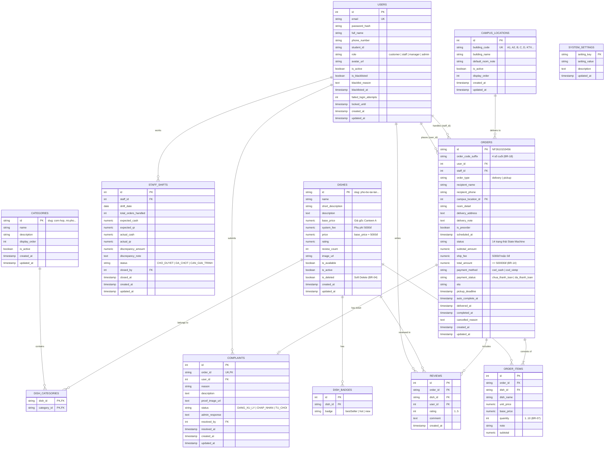

# Tài Liệu Thiết Kế Cơ Sở Dữ Liệu NEUFood (12 Bảng Chuẩn Nghiệp Vụ) 🗄️

Hệ thống cơ sở dữ liệu quan hệ cho **NEUFood** sử dụng **PostgreSQL 16+** (tương thích với SQLAlchemy ORM cho cả MS SQL Server), hỗ trợ ràng buộc toàn vẹn dữ liệu (`CHECK CONSTRAINT`), trigger tự động cập nhật `updated_at` và chỉ mục tối ưu truy vấn.

---

## 1. Sơ Đồ Thực Thể Quan Hệ (Entity-Relationship Diagram - 12 Bảng)



---

## 2. Chi Tiết Các Tệp Trong Thư Mục `database/`

- [`init_db.sql`](./init_db.sql): Định nghĩa DDL hoàn chỉnh cho 12 bảng, Khóa chính, Khóa ngoại, Ràng buộc `CHECK`, Trigger tự động cập nhật `updated_at`, và hệ thống Indexes.
- [`sample_data.sql`](./sample_data.sql): Dữ liệu mẫu chuẩn nghiệp vụ gồm 6 tài khoản (4 roles + tài khoản Blacklist COD), 8 tòa nhà nội khu NEU, 8 danh mục, 65 món ăn & combo (đồng bộ đầy đủ từ giao diện frontend cũ), 11 tham số hệ thống, 6 đơn hàng trải rộng các trạng thái, đánh giá, khiếu nại và biên bản chốt ca COD.
- [`erd.html`](./erd.html): Sơ đồ ERD tương tác trực quan mở trực tiếp trên trình duyệt.

---

## 3. Hướng Dẫn Khởi Tạo & Xem Database

- **Khởi chạy tự động qua Docker Compose:**
  ```bash
  docker compose up -d database
  ```
- **Xem trực quan bằng TablePlus (macOS / Windows) hoặc MS SQL Server (Windows):**
  Xem hướng dẫn chi tiết từng bước tại **[docs/TESTING_AND_DATABASE_GUIDE.md](../docs/TESTING_AND_DATABASE_GUIDE.md)**.
