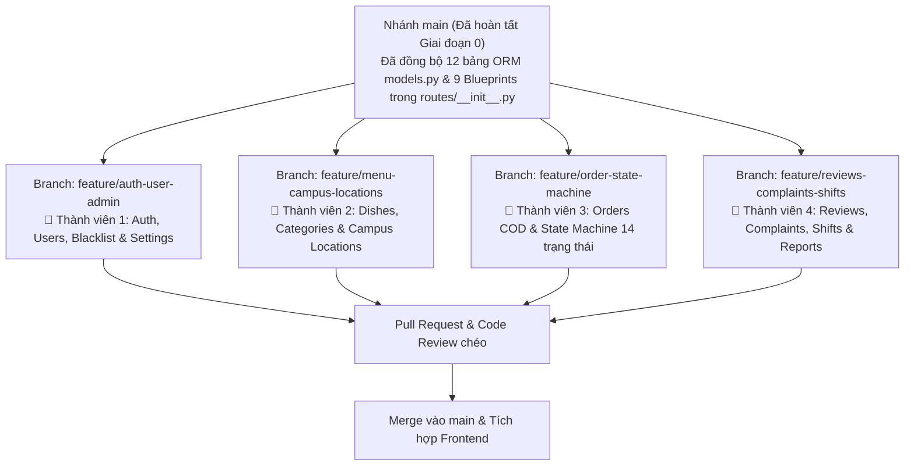
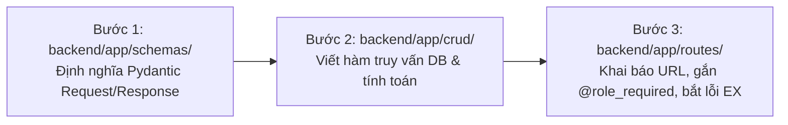

# KẾ HOẠCH PHÂN CÔNG HOÀN THIỆN BACKEND NEUFOOD (NHÓM 4 THÀNH VIÊN) 📋

Tài liệu này quy định phân chia phạm vi công việc (Ownership), các nhánh Git độc lập, danh sách file riêng biệt và các Use Cases / Business Rules / Exceptions mà mỗi thành viên trong nhóm 4 người cần hoàn thiện để **không xảy ra xung đột code (Git Conflict)**.

---

## 1. Sơ Đồ Phân Nhánh Git & Phạm Vi Phụ Trách



> **Quy tắc vàng chống Conflict:**
> Toàn bộ 12 bảng ORM trong `backend/app/db/models.py` và đăng ký Blueprint trong `backend/app/routes/__init__.py` **đã được cấu hình sẵn**. Mỗi thành viên chỉ chỉnh sửa các file thuộc phân hệ của mình dưới đây. Nếu cần sửa `models.py`, phải báo trước cho cả nhóm.

---

## 2. Ma Trận Phân Bổ Khối Lượng Công Việc (25% / Thành Viên)

| Thành viên | Nhánh Git (`feature/...`) | Các file được phép chỉnh sửa | Use Cases | Business Rules | Ngoại lệ (Exceptions) |
| :--- | :--- | :--- | :--- | :--- | :--- |
| **Thành viên 1** | `feature/auth-user-admin` | - `schemas/auth.py`, `schemas/user.py`, `schemas/setting.py`<br/>- `crud/user.py`, `crud/setting.py`<br/>- `routes/auth.py`, `routes/user.py`, `routes/setting.py` | `UC01`, `UC02`, `UC03`, `UC04`, `UC05`, `UC23` | `BR-01`, `BR-02`, `BR-03`, `BR-22` | `EX-01`, `EX-02`, `EX-03`, `EX-04`, `EX-22` |
| **Thành viên 2** | `feature/menu-campus-locations` | - `schemas/dish.py`, `schemas/location.py`<br/>- `crud/dish.py`, `crud/location.py`<br/>- `routes/dish.py`, `routes/location.py` | `UC06`, `UC07`, `UC09` *(vị trí)*, `UC16`, `UC21`, `UC24` | `BR-04`, `BR-06`, `BR-09`, `BR-10`, `BR-12` | `EX-05`, `EX-07`, `EX-21`, `EX-23` |
| **Thành viên 3** | `feature/order-state-machine` | - `schemas/order.py`<br/>- `crud/order.py`<br/>- `routes/order.py` | `UC08`, `UC09` *(giờ hẹn)*, `UC10` $\rightarrow$ `UC13`, `UC17` $\rightarrow$ `UC19` | `BR-05`, `BR-07`, `BR-08`, `BR-11`, `BR-13` $\rightarrow$ `BR-21` | `EX-06`, `EX-08` $\rightarrow$ `EX-13`, `EX-16` $\rightarrow$ `EX-19` |
| **Thành viên 4** | `feature/reviews-complaints-shifts` | - `schemas/review.py`, `schemas/complaint.py`, `schemas/shift.py`<br/>- `crud/review.py`, `crud/complaint.py`, `crud/shift.py`<br/>- `routes/review.py`, `routes/complaint.py`, `routes/shift.py` | `UC14`, `UC15`, `UC20`, `UC22`, `UC25` | `BR-23`, `BR-24`, `BR-25` | `EX-14`, `EX-15`, `EX-20` |

---

## 3. Checklist Chi Tiết Từng Thành Viên

### 👤 Thành Viên 1: Auth, Users, Blacklist COD & System Settings
**Lệnh khởi tạo nhánh:**
```bash
git checkout main && git pull origin main
git checkout -b feature/auth-user-admin
```
- [ ] **`UC01` - Đăng ký (`POST /api/v1/auth/register`):**
  - Kiểm tra SĐT 10 số hợp lệ (`BR-01`), chặn trùng `email` hoặc `student_id` (`EX-01`), gán mặc định `role = 'customer'`.
- [ ] **`UC02` - Đăng nhập & Khóa tài khoản tạm thời (`POST /api/v1/auth/login`):**
  - Kiểm tra `locked_until`: nếu chưa hết hạn khóa 15 phút thì chặn đăng nhập (`EX-02`).
  - Sai mật khẩu 5 lần liên tiếp $\rightarrow$ khóa tài khoản 15 phút (`BR-02`, `EX-02`).
  - Đăng nhập đúng $\rightarrow$ reset `failed_login_attempts = 0`, trả về thông tin user kèm `is_blacklisted`, `blacklist_reason`.
- [ ] **`UC04` & `UC05` - Hồ sơ cá nhân & Mật khẩu (`/api/v1/users/profile`, `/api/v1/auth/change-password`):**
  - Chặn trùng số điện thoại với tài khoản khác khi cập nhật hồ sơ (`EX-03`).
  - Đổi mật khẩu và khôi phục mật khẩu OTP (`EX-04`).
- [ ] **`UC23` - Quản trị Tài khoản & Blacklist COD (`/api/v1/users/admin/...` - Role: `admin`):**
  - `GET /api/v1/users/admin/all`: Lọc người dùng theo `role`, `is_blacklisted`, từ khóa.
  - `PATCH /api/v1/users/admin/<id>/status`: Khóa/mở khóa tài khoản, phân quyền `staff`/`manager`/`admin`. Chặn khóa nếu user đang có đơn hàng chưa hoàn tất (`EX-22`).
  - `PATCH /api/v1/users/admin/<id>/blacklist`: Đưa vào hoặc gỡ khỏi Blacklist COD (`BR-22`).
- [ ] **Cấu hình hệ thống (`GET/PUT /api/v1/settings` - Role: `admin`):**
  - Quản lý các tham số trong bảng `system_settings`.

---

### 👤 Thành Viên 2: Thực Đơn, Danh Mục, Upload Ảnh & Địa Điểm Nội Khu NEU
**Lệnh khởi tạo nhánh:**
```bash
git checkout main && git pull origin main
git checkout -b feature/menu-campus-locations
```
- [ ] **`UC06` & `UC07` - Xem, Tìm kiếm & Lọc thực đơn (`GET /api/v1/dishes`, `GET /api/v1/dishes/<id>`):**
  - Lọc bỏ các món `is_deleted == True`. Trả đầy đủ `base_price`, `system_fee` (5.000đ), `price`, `is_available`, `category_ids`, `badges`.
  - Bổ sung API kiểm tra giỏ hàng (`POST /api/v1/dishes/validate-cart`) báo lỗi `EX-05` nếu món trong giỏ vừa bị Canteen đánh dấu hết hàng.
- [ ] **`UC16` - Bật/Tắt nhanh trạng thái Còn/Hết món (`PATCH /api/v1/dishes/<id>/availability`):**
  - Cho phép cả `staff`, `manager`, `admin` bật/tắt `is_available` (`BR-06`).
- [ ] **`UC21` - Quản lý Thực đơn CRUD & Công thức giá (`/api/v1/dishes` - Role: `manager`, `admin`):**
  - Tự động tính `price = base_price + 5000` theo `BR-12`.
  - Khi gọi `DELETE /api/v1/dishes/<id>`: Kiểm tra bảng `order_items`. Nếu món đã từng có đơn hàng $\rightarrow$ chặn xóa cứng, chỉ chuyển `is_deleted = True, is_active = False, is_available = False` (`BR-04`, `EX-21`).
  - Thêm route `POST /api/v1/dishes/upload-image` dùng hàm `save_upload_file()`.
- [ ] **`UC09` & `UC24` - Quản lý Địa điểm nội khu NEU (`/api/v1/locations`):**
  - `GET /api/v1/locations`: Danh sách tòa nhà (`A1`, `A2`, `B`, `C`, `D`, `KTX`, `THU_VIEN`, `NHA_VAN_HOA`) cho khách chọn (`BR-09`, `EX-07`).
  - `POST / PUT / DELETE /api/v1/locations/<id>` (Role: `admin`): Chặn xóa địa điểm đang có đơn hàng đang giao, chỉ cho đổi `is_active = False` (`BR-10`, `EX-23`).

---

### 👤 Thành Viên 3: Đặt Hàng COD, State Machine 14 Trạng Thái & Bàn Giao 4 Số Cuối
**Lệnh khởi tạo nhánh:**
```bash
git checkout main && git pull origin main
git checkout -b feature/order-state-machine
```
- [ ] **`UC08`, `UC09`, `UC10` - Tạo đơn hàng COD (`POST /api/v1/orders`):**
  - Kiểm tra tài khoản không nằm trong Blacklist COD (`BR-22`, `EX-10`).
  - Kiểm tra khách không có đơn hàng nào đang hoạt động (`CHO_XAC_NHAN`, `DANG_CHUAN_BI`, `DANG_GIAO`, `SAN_SANG_LAY`, `GIAO_THAT_BAI`) (`BR-08`, `EX-09`).
  - Kiểm tra mọi món trong đơn đều `is_available == True` (`EX-05`) và số lượng mỗi món $\le 10$ (`BR-07`, `EX-06`).
  - Nếu `order_type == 'delivery'`: kiểm tra `campus_location_id` hợp lệ (`BR-09`, `EX-07`), `ship_fee = 5000`. Nếu `pickup`: `ship_fee = 0` (`BR-13`).
  - Nếu `is_preorder == True`: kiểm tra `scheduled_at` cách hiện tại $\ge 30$ phút (`BR-11`, `EX-08`).
  - Chốt `unit_price`, `base_price` tại thời điểm đặt (`BR-05`) và chặn nếu `total_amount > 500000` (`BR-14`, `EX-11`).
  - Lưu 4 chữ số cuối mã đơn vào `order_code_suffix` (`BR-18`).
- [ ] **`UC12` - Khách hủy đơn (`POST /api/v1/orders/<id>/cancel`):**
  - Chỉ cho hủy khi `status == 'CHO_XAC_NHAN'`. Nếu đã sang `DANG_CHUAN_BI` thì báo lỗi `EX-12` (`BR-17`).
- [ ] **`UC17` & `UC18` - Canteen duyệt đơn & Cập nhật tiến độ nấu (`PATCH /api/v1/orders/<id>/status`):**
  - Duyệt đơn trong 10 phút (`BR-16`, `EX-16`): `CHO_XAC_NHAN` $\rightarrow$ `DANG_CHUAN_BI` hoặc `TU_CHOI`.
  - Nấu xong: chuyển sang `DANG_GIAO` (đơn giao tận nơi) hoặc `SAN_SANG_LAY` (đơn tại quầy, gán `pickup_deadline = now + 30p` theo `BR-21`).
- [ ] **`UC19` - Bàn giao đối chiếu 4 số cuối & Xử lý sự cố Boom hàng (`POST /api/v1/orders/<id>/handover`, `/delivery-issue`):**
  - Kiểm tra 4 số cuối `order_code_suffix` trùng khớp mới cho chuyển sang `DA_GIAO` / `DA_BAN_GIAO` và `payment_status = 'da_thanh_toan'` (`BR-18`, `EX-17`).
  - Nếu khách không nghe máy: chuyển sang `GIAO_THAT_BAI` giữ tại quầy 30 phút (`BR-20`, `EX-18`).
  - Nếu quá 30 phút không nhận hoặc từ chối trả tiền COD: chuyển đơn sang `BO_DON_BLACKLIST` và tự động khóa `user.is_blacklisted = True` (`BR-22`, `EX-18`, `EX-19`).
- [ ] **`UC13` - Khách xác nhận đã nhận hàng (`POST /api/v1/orders/<id>/confirm-receipt`):**
  - Chuyển sang `HOAN_THANH` (`EX-13`).

---

### 👤 Thành Viên 4: Đánh Giá Món, Khiếu Nại Đơn Hàng, Chốt Ca COD & Báo Cáo Doanh Thu
**Lệnh khởi tạo nhánh:**
```bash
git checkout main && git pull origin main
git checkout -b feature/reviews-complaints-shifts
```
- [ ] **`UC14` - Đánh giá món ăn (`POST /api/v1/reviews`, `GET /api/v1/reviews/dish/<dish_id>`):**
  - Cho phép khách đánh giá (1–5 sao, nhận xét) cho món ăn trong đơn đã giao/hoàn thành của chính mình.
  - Tự động tính lại điểm trung bình `dish.rating` và tăng `dish.review_count`.
- [ ] **`UC15` & `UC25` - Gửi & Phân xử Khiếu nại (`/api/v1/complaints`):**
  - `POST /api/v1/complaints` (Khách hàng): Kiểm tra đơn đã giao trong vòng 24 giờ (`BR-23`, `EX-14`), bắt buộc có ảnh bằng chứng `proof_image_url` (`EX-15`), tối đa 1 khiếu nại/đơn. Đổi trạng thái đơn sang `KHIEU_NAI`.
  - `PATCH /api/v1/complaints/<id>/resolve` (Độc quyền `admin` - `BR-24`): Admin cập nhật kết quả `CHAP_NHAN` hoặc `TU_CHOI` kèm `admin_response`, đổi trạng thái đơn sang `DA_GIAI_QUYET`.
- [ ] **`UC20` - Chốt ca & Đối soát tiền COD cuối ca (`/api/v1/shifts` - `BR-25`, `EX-20`):**
  - `GET /api/v1/shifts/my-current-shift`: Tính tổng số đơn đã giao trong ngày của nhân viên, tổng tiền mặt dự kiến (`expected_cash`) và QR dự kiến (`expected_qr`).
  - `POST /api/v1/shifts/submit`: Nhân viên nhập `actual_cash`, `actual_qr`, tính độ lệch `discrepancy_amount`. Nếu lệch $\neq 0$, yêu cầu giải trình (`EX-20`).
  - `PATCH /api/v1/shifts/<id>/close` (Role: `manager`, `admin`): Quản lý duyệt chốt ca (`DA_CHOT` / `CAN_GIAI_TRINH`).
- [ ] **`UC22` - Báo cáo doanh thu Canteen & Hệ thống (`GET /api/v1/shifts/reports/summary` - Role: `manager`, `admin`):**
  - Tổng hợp doanh thu theo ngày/tuần/tháng, tách doanh thu gốc Canteen ($\sum \text{base\_price}$), phụ phí hệ thống ($\sum 5.000\text{đ}$), phí ship, tỷ lệ đơn thành công/hủy/boom hàng và top món bán chạy.

---

## 4. Hướng Dẫn Quy Trình Code 3 Tầng Cho Mỗi Thành Viên (`schemas` $\rightarrow$ `crud` $\rightarrow$ `routes`)

> **Lưu ý quan trọng:** Các hàm có sẵn hiện tại trong `schemas/`, `crud/`, `routes/` chỉ là **20% khung mẫu ban đầu (Starter Template)** để server khởi chạy được và làm mẫu thống nhất cách viết code. **80% khối lượng nghiệp vụ thực tế** (các class Schema mới, các hàm truy vấn/kiểm tra điều kiện trong CRUD, các API xử lý nghiệp vụ và 25 Business Rules / 23 Exceptions) đòi hỏi mỗi thành viên phải tự thiết kế và code tiếp trên cả **3 tầng** sau:



Khi bắt tay vào làm một mục trong Checklist (hoặc khi thêm bất kỳ API nào), thành viên thực hiện tuần tự 3 bước:

1. **Bước 1 – Viết/Mở rộng Schema tại `backend/app/schemas/<module>.py`:**
   - **Không giới hạn ở các class có sẵn!** Mỗi khi làm một API mới nhận dữ liệu từ Client (ví dụ: TV1 làm API quên mật khẩu `ForgotPasswordRequest`, khóa tài khoản `AdminUserStatusRequest`; TV2 làm API kiểm tra giỏ hàng `CartValidateRequest`; TV3 làm API duyệt đơn `OrderProcessRequest`, bàn giao 4 số `OrderHandoverRequest`, báo sự cố `OrderIssueRequest`...), bạn **phải tạo thêm class Pydantic `BaseModel` mới** trong file `schemas/` của mình để validate dữ liệu đầu vào.
2. **Bước 2 – Viết hàm truy vấn & tính toán tại `backend/app/crud/<module>.py`:**
   - Viết các hàm thao tác với `db: Session` (SQLAlchemy): lọc dữ liệu, kiểm tra các điều kiện nghiệp vụ trong DB (như kiểm tra tài khoản có đơn đang hoạt động không, kiểm tra địa điểm có đơn đang giao không, tính lại `dish.rating`, tổng hợp tiền COD trong ca...).
3. **Bước 3 – Khai báo Endpoint & Phân quyền tại `backend/app/routes/<module>.py`:**
   - Khai báo `@<bp>.route(...)`, gắn decorator `@jwt_required` hoặc `@role_required(...)`.
   - Validate request bằng Schema ở Bước 1 $\rightarrow$ mở `with get_db() as db:` gọi hàm CRUD ở Bước 2 $\rightarrow$ kiểm tra và trả về thông báo lỗi chuẩn theo kịch bản `EX-01` $\rightarrow$ `EX-23` thông qua hàm `api_response()`.

---

## 5. Quy Tắc Xử Lý Khi Phát Sinh API Mới, Tính Năng Mới Hoặc Quyết Định Mới

Tài liệu `API_DOCUMENTATION.md` và `PHAN_CONG_BACKEND.md` là **Baseline (Khung chuẩn ban đầu)**. Trong quá trình code và ghép nối với Frontend, nếu phát sinh thêm API hoặc quyết định mới, các thành viên xử lý theo **3 cấp độ** sau:

### 🟢 Cấp độ 1: Phát sinh API / Logic mới nằm gọn trong phân hệ của mình (Tự quyết 100%)
- **Tình huống:** Bạn nhận thấy phân hệ của mình cần thêm API phụ trợ (ví dụ: TV2 muốn thêm `GET /api/v1/dishes/top-selling` hoặc `GET /api/v1/dishes/random`; TV3 muốn thêm `GET /api/v1/orders/active`; TV1 muốn tách riêng API xem danh sách Blacklist).
- **Cách xử lý:**
  1. Bạn **toàn quyền chủ động tạo thêm** class trong `schemas/`, hàm trong `crud/` và route trong `routes/` thuộc các file của mình mà không cần chờ nhóm trưởng.
  2. Cập nhật bổ sung mô tả API mới đó vào phần của bạn trong `docs/API_DOCUMENTATION.md` trước khi tạo Pull Request.

### 🟡 Cấp độ 2: Phát sinh cần đọc dữ liệu từ phân hệ của thành viên khác (Chỉ Import, Không sửa file bạn khác)
- **Tình huống:** TV3 khi tạo đơn (`crud/order.py`) cần đọc cấu hình `max_cod_amount` từ bảng `system_settings` của TV1; hoặc TV4 khi xử lý khiếu nại (`crud/complaint.py`) cần đọc thông tin đơn hàng của TV3.
- **Cách xử lý:**
  1. Được phép `import` các class ORM từ `app.db.models` hoặc các hàm `get_...` từ `app.crud.<module_khac>` vào file của mình để đọc dữ liệu.
  2. **Không tự ý sửa file thuộc phân hệ của người khác** để tránh xảy ra Git Conflict khi merge. Nếu cần một hàm helper mới bên phân hệ bạn khác, hãy nhắn tin trao đổi để bạn đó bổ sung.

### 🔴 Cấp độ 3: Phát sinh thay đổi cấu trúc bảng Database (`models.py` & `init_db.sql`)
- **Tình huống:** Cần thêm cột mới hoặc bảng mới vào Database.
- **Cách xử lý:**
  1. Báo lên nhóm chat để thống nhất tên bảng/cột.
  2. Tạo một Pull Request nhỏ chỉ sửa `database/init_db.sql` và `backend/app/db/models.py`, merge vào `main` trước.
  3. Cả 4 thành viên chạy `git fetch origin && git merge origin/main` để đồng bộ `models.py` mới nhất về nhánh đang làm.

