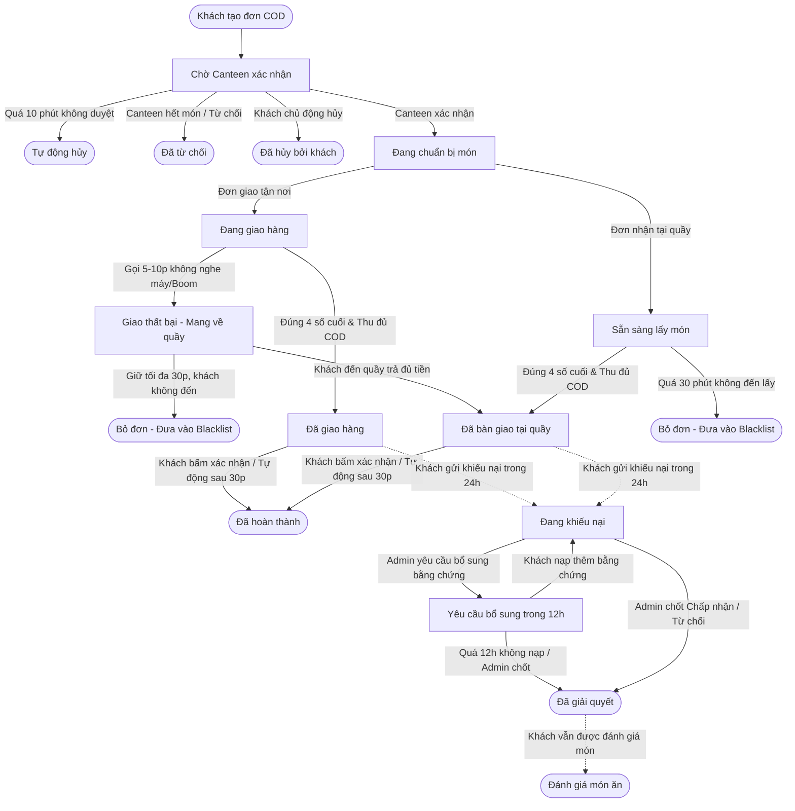

# TÀI LIỆU ĐẶC TẢ QUY TRÌNH VÀ QUY TẮC NGHIỆP VỤ HỆ THỐNG
# HỆ THỐNG QUẢN LÝ ĐẶT VÀ GIAO ĐỒ ĂN NỘI KHU CANTEEN ĐẠI HỌC KINH TẾ QUỐC DÂN (NEUFOOD)

---

## MỤC LỤC
1. [Chương 1: Tổng quan hệ thống và Phạm vi nghiệp vụ](#chương-1-tổng-quan-hệ-thống-và-phạm-vi-nghiệp-vụ)
2. [Chương 2: Actors và Ma trận phân quyền](#chương-2-actors-và-ma-trận-phân-quyền)
3. [Chương 3: Vòng đời đơn hàng và State Machine](#chương-3-vòng-đời-đơn-hàng-và-state-machine)
4. [Chương 4: Quy tắc nghiệp vụ cốt lõi (Business Rules)](#chương-4-quy-tắc-nghiệp-vụ-cốt-lõi-business-rules)
5. [Chương 5: Danh mục Use Case chi tiết](#chương-5-danh-mục-use-case-chi-tiết)
6. [Chương 6: Danh mục và Kịch bản xử lý ngoại lệ (Exceptions)](#chương-6-danh-mục-và-kịch-bản-xử-lý-ngoại-lệ-exceptions)

---

## CHƯƠNG 1: TỔNG QUAN HỆ THỐNG VÀ PHẠM VI NGHIỆP VỤ

### 1.1. Bối cảnh và Mục tiêu
Hệ thống **NEUFood** được xây dựng nhằm giải quyết nhu cầu cung cấp suất ăn nhanh chóng, tiện lợi cho sinh viên, giảng viên và cán bộ nhân viên trong khuôn viên Đại học Kinh tế Quốc dân (NEU). Hệ thống tập trung tối ưu hóa hoạt động vận hành của Canteen trường (Canteen A2), hỗ trợ đặt trước đồ ăn và giao tận nơi tới các phòng học, giảng đường hoặc nhận tại quầy.

### 1.2. Phạm vi vận hành
* **Đơn vị cung cấp dịch vụ:** Canteen A2 - Đại học Kinh tế Quốc dân.
* **Địa bàn phục vụ:** Toàn bộ khuôn viên Đại học Kinh tế Quốc dân (Tòa nhà Thế kỷ A1, Nhà A2, các tòa nhà B, C, D, Ký túc xá, Thư viện, Nhà văn hóa, v.v.).
* **Hình thức phục vụ:**
  1. *Giao tận nơi (Delivery):* Nhân viên Canteen giao đồ ăn đến tận cửa phòng học, văn phòng làm việc trong khuôn viên trường.
  2. *Nhận tại quầy (Pick-up):* Khách hàng đặt trước qua hệ thống và đến quầy Canteen A2 nhận đồ khi có thông báo món đã sẵn sàng.

### 1.3. Cơ chế Định giá, Biểu phí và Doanh thu
* **Giá niêm yết trên hệ thống:**
  $$\text{Giá niêm yết} = \text{Giá gốc tại quầy } (A) + 5.000\text{ VNĐ}$$
  *(Trong đó, 5.000 VNĐ là phụ phí dịch vụ, duy trì và bảo trì hệ thống trực tuyến).*
* **Phí vận chuyển (Shipping Fee):**
  * Đơn hàng giao tận nơi: Áp dụng mức phí vận chuyển cố định **5.000 VNĐ / đơn hàng** (áp dụng đồng giá cho mọi vị trí trong khuôn viên NEU).
  * Đơn hàng nhận tại quầy: **0 VNĐ**.
* **Công thức tổng tiền thanh toán:**
  * Đơn giao tận nơi: $\text{Tổng thanh toán} = \sum (\text{Giá niêm yết} \times \text{Số lượng}) + 5.000\text{ VNĐ (ship)}$
  * Đơn nhận tại quầy: $\text{Tổng thanh toán} = \sum (\text{Giá niêm yết} \times \text{Số lượng})$
* **Phân bổ doanh thu & Mốc thời gian ghi nhận kế toán:**
  * Cơ cấu doanh thu: $\text{Tổng doanh thu gộp (Gross)} = \text{Doanh thu gốc Canteen (Net)} + \text{Phụ phí bảo trì hệ thống} + \text{Phí vận chuyển}$.
  * Mốc thời gian ghi nhận doanh thu: Doanh thu của các đơn hàng đã thu tiền COD (`payment_status == 'da_thanh_toan'`) được ghi nhận thống nhất căn cứ theo **thời điểm bàn giao thực tế (`delivered_at`)** theo chuẩn múi giờ Việt Nam (UTC+7). Quy tắc này bảo đảm số liệu doanh thu Canteen khớp chính xác 100% với số tiền mặt và sao kê QR nhân viên nộp lại theo ca trực trong ngày (BR-25). Các đơn hàng hủy hoặc từ chối (không phát sinh dòng tiền) được thống kê theo thời điểm tạo đơn (`created_at`).

### 1.4. Phương thức thanh toán và Mô hình vận hành nhân sự
* **Phương thức thanh toán:** Hệ thống áp dụng duy nhất hình thức **COD (Cash On Delivery - Thanh toán khi nhận hàng)**. Khách hàng thanh toán trực tiếp khi nhận đồ ăn bằng một trong hai cách:
  * Trả tiền mặt trực tiếp cho nhân viên bàn giao.
  * Quét mã QR chuyển khoản ngân hàng (VietQR) trực tiếp vào tài khoản của nhân viên bàn giao tại thời điểm nhận hàng.
* **Mô hình nhân viên giao hàng (Shipper nội bộ):**
  * Đội ngũ giao hàng là nhân viên chính thức của Canteen A2, hưởng lương cố định từ Canteen, không hưởng hoa hồng đơn hàng hay phí ship riêng.
  * Nhân viên tự giác nhận đơn và giao đồ ăn cho khách.
  * **Quy trình chốt ca & đối soát:** Cuối mỗi ca làm việc, nhân viên tổng hợp toàn bộ tiền mặt đã thu và sao kê chuyển khoản QR, đối chiếu với Báo cáo doanh thu trên hệ thống và nộp lại toàn bộ tiền cho Thu ngân / Quản lý Canteen.

---

## CHƯƠNG 2: ACTORS VÀ MA TRẬN PHÂN QUYỀN

### 2.1. Định nghĩa danh mục Actor
| STT | Actor | Loại Actor | Mô tả | Yêu cầu đăng nhập |
| :---: | :--- | :--- | :--- | :---: |
| 1 | **Khách vãng lai** (*Guest*) | Phụ | Người dùng truy cập website nhưng chưa đăng nhập tài khoản. | Không |
| 2 | **Khách hàng** (*Customer*) | Chính | Sinh viên, học viên, giảng viên, cán bộ công nhân viên thuộc NEU. | Có |
| 3 | **Nhân viên Canteen** (*Staff*) | Chính | Nhân viên chế biến, đóng gói và trực tiếp giao đồ ăn nội khu của Canteen A2. | Có |
| 4 | **Quản lý Canteen** (*Manager*) | Chính | Quản lý điều hành trực tiếp Canteen A2 (thực đơn, doanh thu, nhân sự). | Có |
| 5 | **Quản trị viên** (*Admin*) | Chính | Người quản trị kỹ thuật và giám sát toàn diện hệ thống NEUFood. | Có |

---

### 2.2. Ma trận phân quyền chức năng tổng quát
| Nhóm chức năng | Chức năng chi tiết | Khách vãng lai | Khách hàng | Nhân viên Canteen | Quản lý Canteen | Quản trị viên (Admin) |
| :--- | :--- | :---: | :---: | :---: | :---: | :---: |
| **Tài khoản** | Đăng ký / Đăng nhập / Quên MK | Cho phép | Cho phép | Cho phép | Cho phép | Cho phép |
| | Cập nhật hồ sơ cá nhân | Không | Cho phép | Cho phép | Cho phép | Cho phép |
| **Thực đơn** | Xem thực đơn, tìm kiếm, lọc món | Cho phép | Cho phép | Cho phép | Cho phép | Cho phép |
| | Cập nhật trạng thái Còn / Hết món | Không | Không | Cho phép | Cho phép | Không |
| | Quản lý món ăn (Thêm, Sửa, Xóa, Đổi giá) | Không | Không | Không | Cho phép | Không |
| **Đặt hàng** | Quản lý giỏ hàng & Tạo đơn COD | Không | Cho phép | Không | Không | Không |
| | Hủy đơn hàng (khi chưa chuẩn bị) | Không | Cho phép | Không | Không | Không |
| | Theo dõi tiến trình đơn hàng | Không | Cho phép | Cho phép | Cho phép | Cho phép |
| **Xử lý đơn** | Tiếp nhận hoặc từ chối đơn hàng | Không | Không | Cho phép | Cho phép | Không |
| | Chuyển trạng thái nấu / hoàn tất chế biến | Không | Không | Cho phép | Cho phép | Không |
| | Giao hàng / Bàn giao tại quầy & thu COD | Không | Không | Cho phép | Cho phép | Không |
| **Sau bán** | Xác nhận đã nhận hàng | Không | Cho phép | Không | Không | Không |
| | Đánh giá món ăn | Không | Cho phép | Không | Không | Không |
| | Gửi khiếu nại đơn hàng | Không | Cho phép | Không | Không | Không |
| | Xử lý khiếu nại (Độc quyền) | Không | Không | Không | Không | Cho phép |
| **Quản trị & Báo cáo** | Quản lý tài khoản & Blacklist COD | Không | Không | Không | Không | Cho phép |
| | Quản lý danh mục địa điểm giao hàng | Không | Không | Không | Không | Cho phép |
| | Cấu hình tham số vận hành hệ thống | Không | Không | Không | Không | Cho phép |
| | Xem báo cáo doanh thu & đối soát ca | Không | Không | Cho phép (ca cá nhân) | Cho phép (Canteen A2) | Cho phép (Toàn hệ thống) |

---

### 2.3. Chi tiết quyền hạn từng Actor

#### 2.3.1. Khách vãng lai (Guest)
* Xem danh sách thực đơn, xem thông tin chi tiết từng món ăn (hình ảnh, thành phần, giá tiền niêm yết).
* Tìm kiếm món ăn theo tên và lọc món theo danh mục/thể loại.
* *Giới hạn:* Không thể quản lý giỏ hàng, không thể đặt hàng, không thể đánh giá hay khiếu nại. Khi nhấn chọn món hoặc đặt mua, hệ thống yêu cầu đăng nhập.

#### 2.3.2. Khách hàng (Customer)
* Đăng ký tài khoản (xác thực email NEU / mã sinh viên), đăng nhập, đăng xuất, đổi mật khẩu.
* Thêm món vào giỏ hàng, tùy chỉnh số lượng (tối đa 10 phần/món).
* Tạo đơn hàng: Chọn hình thức nhận (Giao tận nơi hoặc Nhận tại quầy), chọn địa điểm phòng học/tòa nhà, chọn thời gian giao (làm ngay hoặc hẹn trước tối thiểu 30 phút).
* Hủy đơn hàng tự động khi Canteen chưa bấm xác nhận chuyển sang chuẩn bị.
* Theo dõi trạng thái đơn hàng theo thời gian thực.
* Nhận hàng: Đối chiếu 4 chữ số cuối của mã đơn hàng, thanh toán COD (tiền mặt / QR).
* Bấm xác nhận nhận hàng, đánh giá sao/bình luận, tạo ticket gửi khiếu nại lên Admin trong vòng 24 giờ.

#### 2.3.3. Nhân viên Canteen (Staff / Shipper nội bộ)
* Đăng nhập hệ thống bằng tài khoản nhân viên được cấp.
* Bật/tắt nhanh trạng thái Còn món / Hết món trong ngày.
* Tiếp nhận đơn hàng mới hoặc bấm từ chối đơn nếu quá tải/hết nguyên liệu.
* Chuyển trạng thái đơn sang "Đang chuẩn bị" khi bắt đầu nấu.
* Đóng gói, chuyển đơn sang "Đang giao" (giao tận nơi) hoặc "Sẵn sàng lấy món" (nhận tại quầy).
* Thực hiện giao hàng tận nơi đến phòng học, yêu cầu khách đọc 4 chữ số cuối mã đơn, thu tiền COD (tiền mặt hoặc mã VietQR cá nhân).
* Bấm xác nhận giao thành công hoặc báo cáo sự cố (khách vắng mặt, không đủ tiền, boom hàng).
* Xem thống kê doanh số cá nhân trong ca làm việc để bàn giao tiền mặt cho Quản lý.

#### 2.3.4. Quản lý Canteen (Manager)
* Sở hữu đầy đủ các quyền vận hành của Nhân viên.
* Quản lý thực đơn: Thêm món mới, cập nhật hình ảnh, sửa mô tả, ẩn món ngừng bán, chỉnh sửa giá bán gốc của Canteen.
* Giám sát toàn bộ tiến độ xử lý đơn hàng của Canteen A2 theo thời gian thực.
* Xem báo cáo doanh thu theo ngày, tuần, tháng; kiểm tra lịch sử đơn hàng; đối soát tiền COD bàn giao từ các nhân viên trong từng ca.
* Xem phản hồi, đánh giá món ăn từ khách hàng.

#### 2.3.5. Quản trị viên hệ thống (Admin)
* Quản lý tài khoản: Kích hoạt, khóa tài khoản, phân quyền quản lý/nhân viên.
* Quản trị Blacklist COD: Xem danh sách các tài khoản vi phạm boom hàng/không nhận hàng; gỡ hoặc thêm thủ công tài khoản vào Blacklist.
* Quản lý danh mục địa chỉ giao hàng nội khu (danh sách tòa nhà, phòng học, giảng đường, KTX).
* Thiết lập tham số hệ thống: Thời gian tự hủy đơn chờ duyệt (10 phút), thời gian giữ món tại quầy (30 phút), thời gian tự động hoàn thành đơn (30 phút), phụ phí hệ thống (5.000đ), phí ship (5.000đ).
* Tiếp nhận, phân xử và giải quyết khiếu nại đơn hàng duy nhất trong hệ thống.
* Xem báo cáo thống kê tổng thể toàn hệ thống.

---

## CHƯƠNG 3: VÒNG ĐỜI ĐƠN HÀNG VÀ STATE MACHINE

### 3.1. Sơ đồ trạng thái đơn hàng (Order State Machine)
Mọi đơn hàng trong hệ thống đều đi theo luồng trạng thái chặt chẽ dưới đây:

### 3.2. Mô tả chi tiết các trạng thái đơn hàng
1. **`CHO_XAC_NHAN` (Chờ Canteen xác nhận):** Đơn hàng vừa được khách tạo thành công. Chuông báo reo tại màn hình Canteen. Canteen có tối đa 10 phút để tiếp nhận hoặc từ chối.
2. **`DANG_CHUAN_BI` (Đang chuẩn bị món):** Canteen đã bấm nhận đơn và tiến hành chế biến. Kể từ thời điểm này, khách hàng không thể tự hủy đơn.
3. **`DANG_GIAO` (Đang giao hàng):** Áp dụng cho đơn giao tận nơi. Nhân viên đã lấy món và đang di chuyển tới phòng học/địa điểm của khách.
4. **`SAN_SANG_LAY` (Sẵn sàng lấy món):** Áp dụng cho đơn nhận tại quầy. Món ăn đã chế biến xong, đóng gói và đặt tại quầy trả món Canteen A2, hệ thống gửi thông báo mời khách đến lấy.
5. **`DA_GIAO` (Đã giao hàng):** Nhân viên giao tận nơi đã kiểm tra 4 số cuối mã đơn, thu đủ tiền COD và ấn xác nhận giao thành công trên app.
6. **`DA_BAN_GIAO` (Đã bàn giao tại quầy):** Nhân viên tại quầy đã đối chiếu 4 số cuối mã đơn, thu đủ tiền COD và bàn giao món cho khách.
7. **`GIAO_THAT_BAI` (Giao thất bại tạm thời):** Nhân viên giao hàng đã đến nơi nhưng gọi điện liên tục 5-10 phút khách không nghe máy hoặc vắng mặt. Đồ ăn được chuyển ngược về quầy Canteen A2 để lưu giữ tối đa 30 phút.
8. **`HOAN_THANH` (Đã hoàn thành):** Đơn hàng kết thúc chu trình nghiệp vụ khi khách hàng ấn "Xác nhận đã nhận hàng" hoặc hệ thống tự động hoàn thành sau 30 phút kể từ lúc giao nếu không phát sinh khiếu nại.
9. **`DA_HUY_KHACH` (Đã hủy bởi khách):** Khách chủ động hủy khi đơn còn ở trạng thái `CHO_XAC_NHAN`.
10. **`TU_CHOI` (Đã từ chối):** Canteen chủ động từ chối do hết món, hết nguyên liệu hoặc đột xuất quá tải.
11. **`TU_DONG_HUY` (Tự động hủy do quá hạn):** Sau 10 phút kể từ lúc tạo đơn, nếu Canteen không thao tác tiếp nhận thì hệ thống tự động hủy đơn.
12. **`BO_DON_BLACKLIST` (Bỏ đơn / Boom hàng):** Khách không đến quầy nhận sau 30 phút lưu giữ hoặc từ chối thanh toán khi giao. Đơn bị đóng, hệ thống tự động đưa tài khoản vào Blacklist COD.
13. **`KHIEU_NAI` $\rightarrow$ `DA_GIAI_QUYET` (Kèm quy trình phân xử nhiều bước & trạng thái `YEU_CAU_BO_SUNG`):** Khách gửi ticket khiếu nại trong vòng 24h sau khi nhận món. Admin tiếp nhận xử lý theo quy trình phân xử 2 bước:
    * *Bước 1 (Yêu cầu bổ sung nếu thiếu bằng chứng - EX-15):* Admin yêu cầu khách hàng gửi thêm ảnh chụp/bằng chứng rõ nét trong vòng 12 giờ. Trong thời gian này, ticket chuyển sang trạng thái `YEU_CAU_BO_SUNG`, đơn hàng vẫn duy trì trạng thái `KHIEU_NAI` (chưa khép đơn).
    * *Bước 2 (Phân xử chung cuộc):* Admin đưa ra quyết định cuối cùng là "Chấp nhận bồi hoàn" hoặc "Từ chối khiếu nại" (hoặc tự động từ chối nếu quá 12h khách không nạp thêm bằng chứng). Đơn hàng chính thức chuyển sang `DA_GIAI_QUYET`.
    * *Quyền đánh giá sau khiếu nại (UC14, BR-23):* Sau khi đơn hàng chuyển sang `DA_GIAI_QUYET`, khách hàng vẫn có quyền gửi đánh giá sao và bình luận về món ăn đã nhận.

---

### 3.3. Quy trình xử lý Đơn hẹn trước (Pre-order) vs SLA vận hành
* **Quy tắc thời gian đặt trước:** Khách hàng được phép chọn giờ giao/nhận hẹn trước. Giờ hẹn phải cách thời điểm tạo đơn **tối thiểu 30 phút** và nằm trong khung giờ mở cửa của Canteen.
* **Quy trình tiếp nhận & xử lý hẹn trước:**
  * Khi khách tạo đơn hẹn giờ, đơn vào trạng thái `CHO_XAC_NHAN`. Canteen vẫn phải xác nhận trong vòng **tối đa 10 phút** để chốt lịch hẹn.
  * Sau khi Canteen bấm xác nhận, đơn được xếp vào hàng chờ theo giờ hẹn (`DANG_CHUAN_BI`).
  * Hệ thống cảnh báo thời điểm bắt đầu chế biến trước giờ hẹn $20$ phút để nhân viên nấu và giao đến đúng thời gian khách đã chọn.
  * Tổng thời gian: $\text{Duyệt (10p)} + \text{Chế biến \& Giao (20p)} = 30\text{ phút}$. Do đó, yêu cầu đặt trước tối thiểu 30 phút hoàn toàn khớp với SLA vận hành.

---

## CHƯƠNG 4: QUY TẮC NGHIỆP VỤ CỐT LÕI (BUSINESS RULES)

### 4.1. Nhóm Tài khoản & Bảo mật
* **BR-01 (Định danh tài khoản):** Mỗi tài khoản chỉ được liên kết với một địa chỉ Email duy nhất (ưu tiên email sinh viên/cán bộ NEU: `@neu.edu.vn` hoặc `@st.neu.edu.vn`). Số điện thoại đăng ký phải là số di động hợp lệ tại Việt Nam (10 chữ số).
* **BR-02 (Bảo mật & Khóa tài khoản):** Người dùng nhập sai mật khẩu quá 5 lần liên tiếp sẽ bị khóa tạm thời 15 phút.
* **BR-03 (Phân tách dữ liệu Canteen):** Nhân viên và Quản lý Canteen chỉ được truy cập dữ liệu đơn hàng và thực đơn của Canteen mình phụ trách. Toàn quyền giám sát hệ thống thuộc về Quản trị viên (Admin).

### 4.2. Nhóm Thực đơn & Quản lý món ăn
* **BR-04 (Tính toàn vẹn dữ liệu món):** Món ăn đã từng phát sinh đơn hàng trong quá khứ tuyệt đối **không được xóa cứng (Hard Delete)** khỏi cơ sở dữ liệu. Khi Canteen ngừng kinh doanh món đó, chỉ được sử dụng tính năng **Ẩn/Vô hiệu hóa (Soft Delete / Deactivate)**.
* **BR-05 (Chốt giá đơn hàng):** Giá món ăn được ghi nhận tại thời điểm bấm "Tạo đơn hàng". Việc Canteen thay đổi giá bán niêm yết sau đó không làm ảnh hưởng đến số tiền của các đơn hàng đã tạo trước đó.
* **BR-06 (Kiểm soát tồn kho món ăn):** Món ăn đang ở trạng thái "Hết món" sẽ bị khóa tính năng thêm vào giỏ hàng. Nếu món hết hàng sau khi đã nằm trong giỏ của khách, hệ thống sẽ cảnh báo yêu cầu xóa món trước khi tạo đơn.

### 4.3. Nhóm Giỏ hàng, Đặt hàng & Phạm vi giao
* **BR-07 (Giới hạn số lượng mua):** Mỗi món ăn trong giỏ hàng chỉ được phép đặt tối đa **10 phần / món** trong một đơn để đảm bảo năng lực phục vụ của bếp.
* **BR-08 (Giới hạn đơn hàng đồng thời):** Mỗi tài khoản khách hàng chỉ được phép có **tối đa 01 đơn hàng đang hoạt động** (chưa chuyển sang trạng thái kết thúc: `HOAN_THANH`, `DA_HUY`, `TU_CHOI`, `BO_DON`) tại cùng một thời điểm. Muốn đặt đơn mới, đơn trước đó phải hoàn tất.
* **BR-09 (Phạm vi địa điểm giao):** Đơn giao tận nơi bắt buộc phải chọn địa điểm hợp lệ nằm trong danh mục nội khu NEU do Admin thiết lập (phòng học cụ thể tại các tòa A1, A2, B, C, D, KTX, Thư viện, v.v.).
* **BR-10 (Khóa xóa địa điểm đang phục vụ):** Địa điểm đang có đơn hàng chưa hoàn thành thì Admin chỉ được phép chuyển sang trạng thái "Tạm ngưng phục vụ", không được xóa khỏi hệ thống.
* **BR-11 (Quy định hẹn giờ):** Đơn đặt hẹn giờ phải có thời gian nhận cách thời điểm tạo đơn tối thiểu 30 phút và phải nằm trong khung giờ mở cửa của Canteen.

### 4.4. Nhóm Thanh toán COD & Biểu phí
* **BR-12 (Phí bảo trì hệ thống):** Mọi món ăn bán qua hệ thống trực tuyến đều có giá niêm yết bằng Giá gốc tại quầy cộng thêm 5.000 VNĐ.
* **BR-13 (Phí vận chuyển cố định):** Đơn giao tận nơi áp dụng phí vận chuyển cố định 5.000 VNĐ/đơn cho mọi địa điểm trong trường. Đơn nhận tại quầy có phí vận chuyển là 0 VNĐ.
* **BR-14 (Hạn mức thanh toán COD):** Giá trị tổng một đơn hàng COD không được vượt quá **500.000 VNĐ**. Đơn vượt hạn mức sẽ bị hệ thống từ chối tạo đơn.
* **BR-15 (Hình thức thu tiền COD):** Nhân viên giao hàng thu đúng số tiền hiển thị trên đơn hàng bằng tiền mặt hoặc cho khách quét mã VietQR cá nhân của nhân viên tại thời điểm nhận hàng.

### 4.5. Nhóm Xử lý đơn, Giao hàng & Bàn giao
* **BR-16 (Thời hạn tiếp nhận đơn):** Canteen phải bấm tiếp nhận hoặc từ chối đơn hàng trong vòng **10 phút** kể từ lúc khách tạo đơn. Quá thời gian này, hệ thống tự động hủy đơn.
* **BR-17 (Quyền hủy đơn của khách):** Khách hàng chỉ có quyền bấm "Hủy đơn" khi đơn hàng đang ở trạng thái `CHO_XAC_NHAN`. Khi Canteen đã bấm chuyển sang `DANG_CHUAN_BI`, khách hàng không thể tự hủy.
* **BR-18 (Quy định đối chiếu mã 4 số khi bàn giao):** Tại thời điểm bàn giao đồ ăn (dù giao tận nơi hay nhận tại quầy), nhân viên bắt buộc yêu cầu khách hàng đọc **4 chữ số cuối của mã đơn hàng**. Chỉ khi trùng khớp mới tiến hành thu tiền và giao đồ ăn.
* **BR-19 (Trách nhiệm giao nhầm):** Trường hợp nhân viên giao nhầm đơn do không đối chiếu đúng 4 chữ số mã đơn, Canteen tự chịu trách nhiệm xử lý nội bộ. Vì là đơn COD, khách hàng chưa thanh toán trước nên hệ thống không phát sinh hoàn tiền trực tuyến.
* **BR-20 (Lưu giữ đơn giao thất bại):** Khi nhân viên giao tận nơi không liên lạc được với khách (chờ 5-10 phút), đơn chuyển sang `GIAO_THAT_BAI`. Món ăn được mang về quầy Canteen giữ tối đa **30 phút**. Khách muốn nhận phải tự ra quầy lấy và thanh toán đầy đủ cả tiền món lẫn tiền ship 5.000đ.
* **BR-21 (Thời gian giữ món tại quầy):** Đối với đơn nhận tại quầy, Canteen lưu giữ món tối đa **30 phút** kể từ khi chuyển sang `SAN_SANG_LAY`. Quá 30 phút khách không đến nhận, đơn bị đóng là bỏ đơn.

### 4.6. Nhóm Chốt ca, Khiếu nại & Blacklist COD
* **BR-22 (Chế tài Blacklist COD - Vi phạm 1 lần):** Khách hàng vi phạm một trong các hành vi sau sẽ bị hệ thống tự động đưa ngay vào **Blacklist COD** và khóa vĩnh viễn quyền đặt hàng trên hệ thống:
  1. Boom hàng / Không nghe máy nhận hàng khi giao tận nơi và không ra quầy lấy sau 30 phút lưu giữ.
  2. Không đến quầy lấy đồ ăn quá 30 phút đối với đơn nhận tại quầy.
  3. Từ chối trả tiền hoặc không đủ tiền thanh toán khi nhân viên giao hàng đến.
* **BR-23 (Quy định gửi khiếu nại):** Khách hàng chỉ được gửi khiếu nại trong vòng **24 giờ** kể từ thời điểm đơn hàng chuyển sang `DA_GIAO` hoặc `DA_BAN_GIAO`. Mỗi đơn hàng chỉ được tạo tối đa 01 khiếu nại kèm hình ảnh/bằng chứng.
* **BR-24 (Thẩm quyền phân xử khiếu nại):** Toàn bộ khiếu nại được tiếp nhận và xử lý **độc quyền bởi Quản trị viên (Admin)** để đảm bảo tính khách quan giữa khách hàng và Canteen.
* **BR-25 (Đối soát nộp tiền cuối ca & Mốc thời gian doanh thu):** Cuối mỗi ca làm việc, nhân viên giao hàng phải đối soát tổng số tiền COD đã thu (gồm tiền mặt và sao kê QR) khớp với Báo cáo doanh thu ca trên hệ thống và nộp đầy đủ lại cho Canteen. Mốc thời gian ghi nhận doanh thu các đơn hàng thành công được tính thống nhất theo **thời điểm bàn giao thực tế (`delivered_at`)** trong ngày (giờ Việt Nam UTC+7); nếu phát sinh chênh lệch tiền mặt/sao kê QR với hệ thống, nhân viên bắt buộc phải có giải trình (`discrepancy_note`) trước khi Quản lý duyệt chốt ca (EX-20).

---

## CHƯƠNG 5: DANH MỤC USE CASE CHI TIẾT

Hệ thống được chuẩn hóa toàn bộ các Use Case liên tục từ **UC01** đến **UC25**, tuyệt đối không đứt đoạn và ánh xạ chính xác với các Business Rules (BR) và Ngoại lệ (EX):

| Mã UC | Tên Use Case | Actor thực hiện | Mức ưu tiên | BR áp dụng | Mã Ngoại lệ liên quan | Mô tả phạm vi nghiệp vụ |
| :---: | :--- | :--- | :---: | :--- | :--- | :--- |
| **UC01** | Đăng ký tài khoản khách hàng | Khách vãng lai | Must | BR-01 | EX-01 | Đăng ký bằng Email NEU và SĐT 10 số. |
| **UC02** | Đăng nhập hệ thống | Tất cả Actors | Must | BR-01, BR-02 | EX-02 | Khóa tạm thời 15p nếu sai liên tiếp 5 lần. |
| **UC03** | Đăng xuất | Tất cả Actors | Must | - | - | Thu hồi quyền truy cập của phiên làm việc. |
| **UC04** | Cập nhật hồ sơ cá nhân | Khách hàng, Canteen, Admin | Should | BR-01 | EX-03 | Đổi SĐT, MSSV, ảnh đại diện. |
| **UC05** | Đổi / Khôi phục mật khẩu | Tất cả Actors | Should | BR-02 | EX-04 | Đổi mật khẩu với mật khẩu cũ hoặc OTP. |
| **UC06** | Xem thực đơn & chi tiết món | Tất cả Actors | Must | BR-04, BR-06, BR-12 | EX-05 | Giá niêm yết = giá gốc + 5.000đ phụ phí. |
| **UC07** | Tìm kiếm & lọc món ăn | Tất cả Actors | Must | BR-04 | - | Lọc theo danh mục và từ khóa tên món. |
| **UC08** | Quản lý giỏ hàng | Khách hàng | Must | BR-06, BR-07 | EX-05, EX-06 | Tối đa 10 phần/món; cảnh báo món hết hàng. |
| **UC09** | Chọn phương thức nhận & Điểm giao | Khách hàng | Must | BR-09, BR-11, BR-13 | EX-07, EX-08 | Giao tận nơi (5k ship) hoặc nhận tại quầy (0đ). |
| **UC10** | Tạo đơn hàng COD | Khách hàng | Must | BR-05, BR-08, BR-12, BR-13, BR-14, BR-22 | EX-09, EX-10, EX-11 | Hạn mức trần 500k COD; tối đa 1 đơn hoạt động. |
| **UC11** | Theo dõi trạng thái đơn hàng | Khách hàng, Canteen, Admin | Must | BR-16, BR-20, BR-21 | - | Bảo mật IDOR: khách chỉ xem được đơn của mình. |
| **UC12** | Khách hủy đơn hàng | Khách hàng | Should | BR-17 | EX-12 | Chỉ hủy khi đơn đang ở CHO_XAC_NHAN. |
| **UC13** | Xác nhận nhận hàng thành công | Khách hàng | Should | BR-18 | EX-13 | Chuyển HOAN_THANH sau khi đã thu tiền COD. |
| **UC14** | Đánh giá món ăn | Khách hàng | Should | BR-23 | - | Áp dụng cho đơn đã nhận (DA_GIAO, DA_BAN_GIAO, HOAN_THANH) và cả đơn sau giải quyết khiếu nại (DA_GIAI_QUYET). |
| **UC15** | Gửi ticket khiếu nại | Khách hàng | Should | BR-23 | EX-14, EX-15 | Tạo ticket trong 24h kể từ khi nhận đơn. |
| **UC16** | Bật / Tắt trạng thái Còn/Hết món | Nhân viên, Quản lý Canteen | Must | BR-06 | - | Nhân viên và Quản lý chuyển đổi tình trạng món. |
| **UC17** | Tiếp nhận hoặc từ chối đơn hàng | Nhân viên, Quản lý Canteen | Must | BR-16, BR-17 | EX-16 | Tiếp nhận trong 10p; từ chối bắt buộc có lý do. |
| **UC18** | Cập nhật tiến độ nấu & Sẵn sàng giao | Nhân viên, Quản lý Canteen | Must | BR-16, BR-17, BR-21 | - | Chuyển DANG_GIAO (delivery) hoặc SAN_SANG_LAY (pickup). |
| **UC19** | Bàn giao đơn & Thu tiền COD | Nhân viên Canteen | Must | BR-15, BR-18, BR-19, BR-20 | EX-17, EX-18, EX-19 | Đối chiếu 4 số cuối; xử lý giao thất bại / boom hàng. |
| **UC20** | Chốt ca và nộp tiền COD | Nhân viên Canteen | Must | BR-25 | EX-20 | Đối chiếu tiền thu với ca trực tính theo delivered_at. |
| **UC21** | Quản lý thực đơn (CRUD món, sửa giá) | Quản lý Canteen | Must | BR-04, BR-05, BR-12 | EX-21 | Độc quyền Quản lý Canteen (Admin không có quyền). |
| **UC22** | Xem báo cáo doanh thu Canteen | Quản lý Canteen, Admin | Should | BR-03, BR-25 | - | Tự động quét SLA; doanh thu đơn thanh toán tính theo delivered_at. |
| **UC23** | Quản lý tài khoản & Blacklist COD | Admin | Must | BR-01, BR-08, BR-22 | EX-22 | Quản trị tài khoản, khóa tài khoản, gỡ Blacklist. |
| **UC24** | Quản lý danh mục địa điểm nội khu | Admin | Must | BR-09, BR-10 | EX-23 | Quản lý danh mục tòa nhà, phòng học trong NEU. |
| **UC25** | Tiếp nhận & Xử lý khiếu nại | Admin | Must | BR-23, BR-24 | EX-15 | Độc quyền Admin phân xử 2 bước: YEU_CAU_BO_SUNG (12h) và Chốt giải quyết. |

---

## CHƯƠNG 6: DANH MỤC VÀ KỊCH BẢN XỬ LÝ NGOẠI LỆ (EXCEPTIONS)

Danh mục ngoại lệ được đánh số liền mạch từ **EX-01** đến **EX-23** và quy định rõ cách xử lý trên hệ thống:

| Mã EX | Giai đoạn | Tình huống ngoại lệ | Kịch bản xử lý của hệ thống |
| :---: | :--- | :--- | :--- |
| **EX-01** | Đăng ký | Email hoặc Mã sinh viên đã tồn tại trên hệ thống. | Hệ thống chặn đăng ký, báo lỗi trùng lặp và điều hướng người dùng sang màn hình Đăng nhập hoặc Quên mật khẩu. |
| **EX-02** | Đăng nhập | Nhập sai thông tin đăng nhập quá 5 lần liên tiếp. | Hệ thống khóa đăng nhập tạm thời trong 15 phút, gửi thông báo cảnh báo và cung cấp link đặt lại mật khẩu qua email. |
| **EX-03** | Cập nhật hồ sơ | Số điện thoại không hợp lệ hoặc đã thuộc tài khoản khác. | Chặn lưu thay đổi, yêu cầu người dùng nhập đúng định dạng số di động 10 số. |
| **EX-04** | Khôi phục mật khẩu | Mã xác nhận OTP hết hiệu lực (quá 5 phút) hoặc nhập sai. | Thông báo mã OTP không hợp lệ, cho phép người dùng ấn nút "Gửi lại mã OTP" (tối đa 3 lần/ngày). |
| **EX-05** | Giỏ hàng | Món ăn bị Canteen đánh dấu "Hết món" khi đang nằm trong giỏ. | Hệ thống đánh dấu đỏ món ăn trong giỏ, hiển thị cảnh báo "Món đã hết hàng", vô hiệu hóa nút "Tạo đơn" cho đến khi khách xóa món đó. |
| **EX-06** | Giỏ hàng | Khách cố tình tăng số lượng món vượt quá 10 phần. | Nút tăng (+) bị vô hiệu hóa, hiển thị thông báo "Số lượng tối đa cho mỗi món là 10 phần". |
| **EX-07** | Chọn địa điểm | Khách chọn địa điểm không có trong danh mục tòa nhà NEU. | Bắt buộc chọn từ danh sách thả xuống do Admin quản lý; không cho phép nhập text tự do ngoài danh mục. |
| **EX-08** | Chọn giờ giao | Khách chọn giờ giao trước thời điểm hiện tại hoặc dưới 30 phút. | Hệ thống chặn xác nhận, thông báo "Đơn hẹn trước phải cách thời điểm hiện tại tối thiểu 30 phút" và đề xuất khung giờ gần nhất. |
| **EX-09** | Tạo đơn | Tài khoản đang có 01 đơn hàng đang hoạt động (chưa xong). | Hệ thống chặn tạo đơn mới, hiển thị thông báo: "Bạn đang có một đơn hàng chưa hoàn tất. Vui lòng hoàn thành đơn hiện tại trước khi đặt đơn mới". |
| **EX-10** | Tạo đơn | Tài khoản đang nằm trong danh sách Blacklist COD. | Hệ thống chặn nút đặt hàng, hiển thị thông báo: "Tài khoản của bạn đã bị khóa tính năng đặt hàng do vi phạm chính sách nhận hàng/thanh toán COD. Vui lòng liên hệ Admin để giải quyết". |
| **EX-11** | Tạo đơn | Tổng giá trị đơn hàng vượt hạn mức 500.000 VNĐ. | Hệ thống chặn tạo đơn, hiển thị cảnh báo: "Đơn hàng COD không được vượt quá 500.000 VNĐ. Vui lòng giảm số lượng món". |
| **EX-12** | Hủy đơn | Khách bấm hủy khi Canteen đã bấm sang "Đang chuẩn bị". | Hệ thống từ chối thao tác hủy, hiển thị thông báo: "Bếp đã bắt đầu nấu đơn hàng của bạn, không thể hủy đơn vào lúc này". |
| **EX-13** | Xác nhận nhận | Canteen đã báo giao nhưng khách không bấm xác nhận nhận hàng. | Sau 30 phút kể từ lúc giao, nếu không có khiếu nại, hệ thống tự động chuyển đơn sang `HOAN_THANH`. |
| **EX-14** | Khiếu nại | Khách gửi khiếu nại khi đơn chưa giao hoặc quá hạn 24 giờ. | Hệ thống khóa nút gửi khiếu nại, hiển thị thông báo "Chỉ được khiếu nại đơn đã giao trong vòng 24 giờ". |
| **EX-15** | Khiếu nại | Khiếu nại thiếu hình ảnh minh chứng hoặc nội dung sai sự thật. | Admin gửi thông báo yêu cầu bổ sung bằng chứng trong 12 giờ. Nếu không bổ sung, Admin đóng khiếu nại với kết luận "Từ chối khiếu nại". |
| **EX-16** | Xử lý đơn | Quá 10 phút Canteen không bấm Tiếp nhận hay Từ chối đơn. | Hệ thống tự động hủy đơn (`TU_DONG_HUY`), gửi thông báo xin lỗi đến khách hàng và ghi log phạt hiệu suất của Canteen. |
| **EX-17** | Bàn giao | Khách đọc sai 4 chữ số cuối của mã đơn hàng khi nhận. | Nhân viên kiên quyết từ chối bàn giao đồ ăn cho đến khi khách mở app đọc đúng mã đơn trùng khớp trên máy nhân viên. |
| **EX-18** | Giao tận nơi | Shipper gọi điện 5-10 phút khách không nghe máy / vắng mặt. | Shipper bấm "Báo giao thất bại", mang món về quầy lưu giữ 30 phút. Nếu khách không đến quầy nhận, hệ thống đóng đơn `BO_DON_BLACKLIST`, tự động đưa tài khoản vào Blacklist COD. |
| **EX-19** | Thanh toán COD | Khách không thanh toán hoặc không đủ tiền trả đơn hàng. | Nhân viên giao hàng không bàn giao đồ ăn, mang món về Canteen, chọn lý do "Khách không thanh toán tiền COD". Hệ thống đóng đơn và đưa ngay tài khoản vào Blacklist COD. |
| **EX-20** | Chốt ca | Tiền thực tế nộp lại lệch so với Báo cáo doanh thu ca. | Quản lý ghi nhận biên bản chênh lệch tiền mặt/chuyển khoản, yêu cầu nhân viên giải trình trước khi ký đóng ca làm việc. |
| **EX-21** | Thực đơn | Quản lý Canteen cố tình xóa món ăn đã từng có lịch sử đặt hàng. | Hệ thống chặn xóa cứng, hiển thị cảnh báo: "Món ăn đã có lịch sử đơn hàng, chỉ được phép Ẩn/Tắt trạng thái kinh doanh". |
| **EX-22** | Quản trị | Admin cố tình xóa tài khoản đang có đơn dở. | Hệ thống chặn thao tác xóa/khóa tài khoản, yêu cầu hoàn tất hoặc hủy toàn bộ đơn dở của tài khoản trước. |
| **EX-23** | Quản lý vị trí | Admin xóa địa điểm nội khu đang có đơn hàng đang giao đến. | Hệ thống ngăn chặn xóa, chỉ cho phép đổi trạng thái sang "Tạm dừng phục vụ". |

---

## TỔNG KẾT VÀ BẢO ĐẢM TOÀN VẸN
1. **Khách vãng lai:** Đã tinh giản tối đa, chỉ có quyền xem, tìm kiếm, lọc thực đơn. Mọi thao tác thêm giỏ/đặt hàng đều yêu cầu đăng nhập.
2. **Phương thức thanh toán:** Duy nhất hình thức **COD** (Tiền mặt hoặc Chuyển khoản QR tại chỗ). Đã loại bỏ hoàn toàn "Thanh toán giả lập" và nghiệp vụ "Hoàn tiền".
3. **Thẩm quyền khiếu nại:** Quy về một đầu mối duy nhất là **Quản trị viên (Admin)** giải quyết minh bạch.
4. **Phân quyền thực đơn:** Nhân viên chỉ được bật/tắt còn/hết món; quyền CRUD món và sửa giá thuộc riêng Quản lý Canteen.
5. **Biểu phí:** Minh bạch công thức $A + 5k$ (phí hệ thống) và $5k$ phí ship cố định nội khu NEU.
6. **Chế tài vi phạm:** Quy định nghiêm ngặt đưa vào **Blacklist COD** ngay sau 1 lần vi phạm (boom hàng/không nhận quá 30p/từ chối trả tiền); đồng thời khống chế tối đa **01 đơn hàng đang hoạt động** trên mỗi tài khoản.
7. **Tính toàn vẹn số liệu:** Các mã Actor (5), Use Case (UC01 - UC25), Business Rules (BR-01 - BR-25), Ngoại lệ (EX-01 - EX-23) đều được đánh số liên tục, liên kết chéo chính xác 100%.
